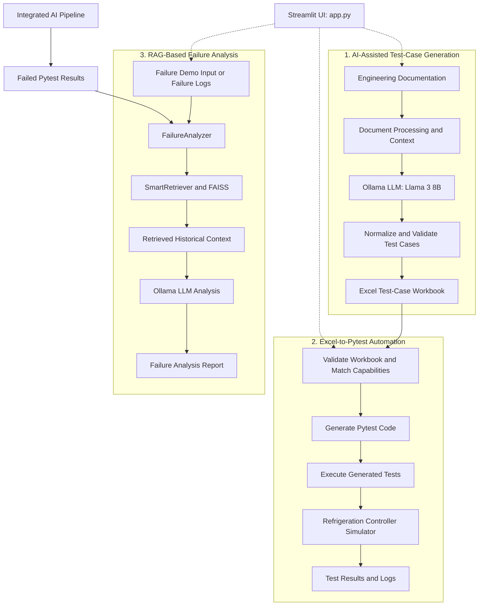

# AI Test Automation Platform

An AI-assisted test automation platform exploring how local Large Language Models (LLMs), Retrieval-Augmented Generation (RAG), Python, and pytest can support quality engineering for HVAC and refrigeration controller scenarios.

The project combines documentation-based test generation, retrieval of relevant engineering context, automated test execution, industrial protocol simulation, and failure analysis.

## Project Overview

The platform explores how AI-assisted workflows can help QA engineers turn technical documentation and historical test-case context into structured test cases and executable automation.

Key areas include:

* AI-assisted test-case generation from project documentation
* RAG-based retrieval of relevant engineering and historical test-case context
* Local LLM inference using Ollama and Llama 3
* Test-case normalization, deduplication, and source-grounding checks
* Python and pytest automation
* BACnet- and Modbus-related simulation scenarios
* Log analysis and AI-assisted failure investigation
* An interactive Streamlit interface

**Project status:** This is an evolving engineering project. The automated test suite has passed in the recorded environment, while the reliability of live AI-generated test cases and complete end-to-end workflows continues to require validation.

## System Architecture

The following diagram describes the principal components and intended data flow.



*This is a conceptual architecture diagram of the project components. The exact execution path depends on the workflow being used; not every operation necessarily invokes the LLM or retrieval pipeline.*

## How RAG and LLMs Are Used

### 1. Embeddings and FAISS

The embedding and retrieval components prepare and search a knowledge base of relevant project information.

* **Embedding model:** `sentence-transformers/all-MiniLM-L6-v2`
* **Vector store:** FAISS
* **Relevant implementation:** `ai_engine/embeddings.py`, `ai_engine/rag_retriever.py`, and `ai_engine/smart_retriever.py`

The embedding model converts text into vector representations. FAISS supports similarity-based retrieval of relevant documents or context for downstream workflows.

### 2. Retrieval-Augmented Generation (RAG)

RAG combines retrieved information with a request before the language model generates a response.

In this project, retrieval components support workflows that need relevant engineering documentation or historical test-case context. This can help ground generated content in project-specific information rather than relying exclusively on the model's general knowledge.

Retrieval improves access to relevant context, but it does not by itself guarantee factual accuracy or complete test coverage.

### 3. Ollama and Llama 3

* **Ollama** provides the local model-inference interface.
* **Llama 3 8B (`llama3:8b`)** is the configured model referenced by the project documentation.

The LLM can generate candidate test cases and assist with analysis in workflows that call it. Generated output must still be checked for correctness, traceability, completeness, and executable assertions.

Relevant implementation includes `ai_engine/base_llm.py` and `ai_engine/llm_client.py`.

### 4. Validation and Test Automation

Generated test cases pass through project-specific processing and validation stages, which may include normalization, deduplication, and source-grounding checks.

The platform also contains components for generating and executing pytest tests, simulating controller scenarios, and analyzing failures. AI-generated tests should be reviewed before being treated as verified engineering tests.

## Technology Stack

| Technology                       | Purpose                                    |
| -------------------------------- | ------------------------------------------ |
| Python                           | Application logic and automation           |
| Streamlit                        | Interactive user interface                 |
| Ollama                           | Local LLM inference                        |
| Llama 3 8B                       | Test generation and analysis where invoked |
| LangChain                        | LLM and retrieval integration              |
| Sentence Transformers            | Text embeddings                            |
| FAISS                            | Vector similarity search                   |
| Pandas and OpenPyXL              | Tabular data and Excel workbook handling   |
| Pytest                           | Automated test execution                   |
| BACnet/Modbus-related simulators | Controller testing scenarios               |

## Prerequisites

* Python 3.11 is recommended for reproducing the recorded test environment.
* Git
* Ollama
* The `llama3:8b` model
* The Python dependencies listed in `requirements.txt`

Install Ollama from the official website: https://ollama.com/

Download the model:

```powershell
ollama pull llama3:8b
```

Ensure Ollama is running before using features that depend on local model inference. Model downloads, inference speed, and generation quality depend on the environment and available hardware.

## Setup

Clone the repository:

```powershell
git clone https://github.com/AKSenthil01/ai-test-automation-platform.git
cd ai-test-automation-platform
```

Create and activate a virtual environment on Windows:

```powershell
python -m venv .venv
.\.venv\Scripts\Activate.ps1
```

Install the dependencies:

```powershell
python -m pip install --upgrade pip
python -m pip install -r requirements.txt
```

## Run the Application

From the project root, launch the Streamlit application:

```powershell
streamlit run app.py
```

Open the local URL displayed by Streamlit in your browser.

The interface brings together the platform's test-generation and automation workflows. Operations that invoke local LLM inference may take substantially longer than ordinary Python tests.

## Quick Verification for a Demonstration

For a short, focused verification before a presentation, run the failure-analyzer test:

```powershell
python -m pytest tests/test_failure_analyzer.py -v
```

This is a focused automated test, not a complete live LLM-generation demonstration. Its duration can vary by environment.

For a live application demonstration:

1. Start Ollama and confirm that `llama3:8b` is available.
2. Launch the Streamlit application using `streamlit run app.py`.
3. Walk through the available test-generation, pytest execution, and failure-analysis workflows.
4. If you trigger live AI generation, allow additional time for model inference and review the generated output before presenting it as correct.

No dedicated `generate_tests_demo.py` script has been confirmed at the expected path, so this README does not prescribe it as an executable demo command.

## Run the Full Automated Test Suite

For broader project verification, run:

```powershell
python -m pytest -q tests
```

**Previously verified baseline:** 26 passed, 0 failed, in 46.60 seconds, with one deprecation warning. Environment: Python 3.11.9 and pytest 9.1.1.

This is a recorded result from the verified merged baseline, not a guarantee of the current runtime on every machine. Passing the collected tests also does not prove that all live LLM-generation workflows produce correct or reproducible output.

## Important Implementation Areas

| Area                                 | Files                                                   |
| ------------------------------------ | ------------------------------------------------------- |
| Embeddings and vector knowledge base | `ai_engine/embeddings.py`                               |
| RAG retrieval                        | `ai_engine/rag_retriever.py`                            |
| Context-aware retrieval              | `ai_engine/smart_retriever.py`                          |
| Local LLM access                     | `ai_engine/base_llm.py`, `ai_engine/llm_client.py`      |
| Test-generation workflow             | `core/ai_test_pipeline.py`, `test_generation/`          |
| Pytest execution pipeline            | `core/e2e_runner.py`                                    |
| Failure analysis                     | `ai_engine/failure_analyzer.py`, `core/failure_demo.py` |
| Interactive interface                | `app.py`                                                |

## Current Limitations and Next Steps

* Improve consistency and uniqueness of AI-generated test cases.
* Validate the complete documentation-to-generation-to-execution workflow.
* Expand negative, boundary, and failure-path coverage.
* Improve handling of malformed or incomplete model responses.
* Continue reviewing source traceability and generated assertions.
* Address dependency deprecation warnings.
* Expand CI/CD and deployment validation.
* Measure live model-generation time and reliability across representative scenarios.

## Intended Use Cases

* Python and pytest automation practice
* AI-assisted quality engineering
* Retrieval-augmented test-generation experiments
* Industrial controller testing scenarios
* Local LLM integration and failure-analysis exploration

## Author

**A. K. Senthil Kumar**

GitHub profile: [AKSenthil01](https://github.com/AKSenthil01)

## Project

[AI Test Automation Platform](https://github.com/AKSenthil01/ai-test-automation-platform)